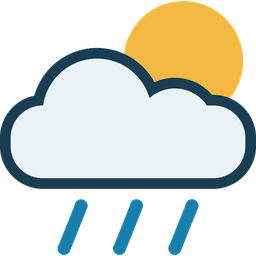

# MeteoSwiss for Home Assistant — maintained fork

**Swiss weather, forecasts and natural-hazard warnings in Home Assistant,
alongside pollen and air quality.** Use them in your own dashboards and
automations, with bundled translations and a documented path for existing users.

This fork continues [LNKtwo/ha-meteoswiss](https://github.com/LNKtwo/ha-meteoswiss)
and brings reviewed corrections together in one maintained version. The original
project provides the foundation; its MIT licence and attribution are retained.
This is an independent community project, not an official MeteoSwiss product.

**Start with the [latest published stable release](https://github.com/martins-netizen/ha-meteoswiss/releases/latest).**
This guide describes the **8.3 series**; [8.3.0 release notes](docs/RELEASE_8.3.0.md)
explain the changes from 8.2.0. Use a published release, not a branch.

**Published on 19 November 2026:** [Stable 8.3.5](https://github.com/martins-netizen/ha-meteoswiss/releases/tag/8.3.5)
is available. Its [dated evidence](docs/RELEASE_EVIDENCE_8.3.5.md) records the
verified tag, release text and publication; installation remains separate.

**About 8.3.5:** this version brings together official measured heating degree
days, more private diagnostics, reliable local state clocks and our engineering
evidence through Gold. It uses the reviewed source in
[PR #131](https://github.com/martins-netizen/ha-meteoswiss/pull/131), signed merge
`115ddad474dcae15aa49fb5f368cbed600adf80d`. The
[cumulative release notes](docs/RELEASE_8.3.5.md) explain changes since stable 8.3.4.
Choose an actually published package from the
[release catalogue](https://github.com/martins-netizen/ha-meteoswiss/releases)
or [latest-stable page](https://github.com/martins-netizen/ha-meteoswiss/releases/latest).
This publication does not establish an installed version. Published beta
packages and earlier releases remain immutable.

The [pre-stable source review](docs/COORDINATOR_CANONICAL_COMPLETION.md) corrected
the ninth coordinator's canonical placement and
[calculated HGT at Swiss midnight](docs/FORECAST_SENSORS.md#calculated-hgt-follows-the-swiss-day).
Native registered-state tests cover the new HGT clock and lifecycle, including
23-/25-hour days and disabled polling. The stable package changes only two
component version fields relative to that approved source; its other 50
component files and all existing security/quality policies remain.

Already accepted b7 behavior needs no repeated migration, failure exercise or
operator observation window. When choosing published stable 8.3.5,
update the existing entry normally and complete its ordinary update restart
once; follow the [stable guide](docs/ACCEPTANCE_8.3.5.md).
Earlier users need no intermediate beta or entry recreation. Keep the station,
options, names, dashboards and retained IDs. The [dated record](docs/RELEASE_EVIDENCE_8.3.5.md)
records completed source, package and publication checks separately from installation.

**Official measured HGT:** a distinct last-observed-day sensor and station-specific
daily/monthly/annual statistics import official SwissMetNet products, backfill
available observations and continue corrections. Forecasts remain predictions.
[Chart, source and removal guidance](docs/HGT_OGD_PLAN.md) explains UTC periods,
gaps, real zero and ownership. Removing the final integration entry removes its
owned OGD-HGT products; ordinary sensor history and unrelated statistics remain.

**Obsolete HGT forecasts:** the native **Settings → System → Repairs → Remove
obsolete HGT forecast statistics** repair recommends complete removal of
attributable old forecasts after explicit confirmation. Opening/cancelling
deletes nothing. Completed cleanup leaves no unused replacement HGT archive.
The deliberately retained [wind arithmetic archive](docs/WIND_STATISTICS_MIGRATION.md)
is separate historical data. Read [upgrade and recovery boundaries](docs/UPGRADING_8.3.5.md)
before deletion. Accepted b3 cleanup and b5/b6/b7 reports stay complete.

| Package | Required HA Core |
|---|---|
| 8.3.5 and 8.3.5b1–b7 | 2026.11.0 or newer |
| Earlier stable 8.3.4 | 2026.8.3 or newer |

The 2026.11 baseline addresses known vulnerabilities in libraries pinned by
older Core versions. Keep Core maintained; the minimum is not permanent
security clearance. CI checks **2026.11.0** and **2026.11.2** with matching
fixtures. [Support rationale](DEVELOPMENT.md#supported-home-assistant-versions).

On supported HA, open **Settings → Marketplace**, search **MeteoSwiss** and
check **martins-netizen/ha-meteoswiss**. Existing HACS installations migrate
with HA 2026.11; do not reinstall HACS or recreate the entry. Marketplace can
show the stable release's minimum beside an installed beta; the
[display guide](docs/MARKETPLACE_VERSION_DISPLAY.md) records that earlier case.

## Four places: what each one is used for

**HA home, pollen measurements, weather measurements and weather forecasts can
refer to four different places.** Each has a specific purpose:

| Place | What it is used for | Example |
|---|---|---|
| **1. HA home location** | The HA base coordinates are used for **modelled air quality, modelled pollen and optional UV via Open-Meteo**. They also define the **MeteoSwiss weather-forecast location** when you keep or explicitly return to the original base coordinates. | Your configured home position in **Kloten**. |
| **2. Pollen measurement station** | **Measured pollen concentrations** from the selected MeteoSwiss pollen station. Independent of weather measurements and weather forecasts. You might want to choose a station near your HA home location. | **Zürich (PZH)**. |
| **3. Weather measurement station** | **Measured current temperature, wind, rain and other observations**, shown on the station device and its original weather entity. You might want to choose a station near your HA home location. | **Zürich/Kloten**. |
| **4. Weather forecast location** | **ICON predictions:** hourly/daily forecasts, eight today/tomorrow sensors and calculated heating degree days. The separate forecast weather entity also shows the chosen point's **current model hour**, which is a prediction rather than a station measurement. | A selected town/postcode point or **Säntis** POI. |

The station weather row can also show a **modelled condition for the measuring station's own location**.
Its numeric values remain measurements; the condition is identified separately
as modelled. See [the source and failure behaviour](docs/STATION_WEATHER_CONDITION.md).

Find nearby SwissMetNet stations on the official
[MeteoSwiss measurement-network map](https://www.meteoswiss.admin.ch/services-and-publications/applications/measuring-networks.html),
then select the station by name in HA. The [setup guide](docs/GETTING_STARTED.md#3-select-pollen-weather-and-warning-locations)
also explains the map-link help included in stable 8.3.2.

For example: **HA home in Kloten, pollen measurements from Zürich, weather
measurements from Zürich/Kloten and weather forecasts for Säntis.** Changing
the forecast to Säntis changes its ICON predictions and calculated HGT. The
Kloten observations, selected pollen measurement station and modelled
AQ/pollen/UV at the base location retain their own places.

**Measured pollen and modelled pollen are different:** the pollen station
supplies measurements; modelled pollen uses the base coordinates. If you choose
an explicit forecast point, that point replaces the base location **only for
the ICON weather forecast role**.

**Warnings use a separate warning postcode**, for example **8302** for Kloten.
A postcode entered in the forecast search selects a forecast point; the warning
postcode selects the warning area. Enter them independently, even when both
are 8302. Choosing Säntis for the forecast does not move the warning postcode
or establish warnings for that mountain. A town/postcode forecast point is a
provider-assigned point, not the exact coordinates of your home.

The alternative **Open-Meteo current-weather source** uses modelled current
conditions at its entered coordinates in place of a weather measurement station.
These entered coordinates also become that entry's base location for
AQ/pollen/UV and its default weather forecast. An explicit forecast selection
still changes only the ICON forecast role.

The existing entry's **Configure (gear)** brings the **weather measuring
station, measured-pollen station and forecast location into one dialog**,
alongside the independent warning postcode. A postcode/town/POI search continues
inside that flow; cancelling preserves previous choices. The HA home location
remains a general HA setting. See the [unified settings and clock-change guide](docs/CALENDAR_AND_LOCATION_SETTINGS.md).

The [selection guide](docs/FORECAST_LOCATION_SETUP.md) and
[data/settings reference](docs/USAGE.md) explain the roles. The named
forecast device/card change is covered in [display and migration](docs/FORECAST_DISPLAY.md).

## Why choose this fork?

- **Less manual patching.** Reviewed fixes and German, English, French and Italian
  UI catalogues ship together. You do not need to copy translation files after
  each update.
- **Warnings with a checked meaning.** The current App v3 source and verified
  warning catalogue address the old wind-code mismatch and the demonstrated
  omission of drought in v1. Active and upcoming warnings retain their severity,
  validity and event text. See the [evidence and limits](docs/WARNING_CODES.md).
- **Understand missing data.** A real zero, a missing individual value and an
  unavailable source are distinct. A failed warning source is not an all-clear;
  an optional pollen or air-quality outage does not block station setup.
- **Build on your existing installation.** Existing setup and the IDs of retained
  entities and statistics are preserved. The [migration guide](docs/MIGRATION.md)
  explains the retired seasonal heating-degree entity, warning-filter changes,
  backup and recovery.
- **See how changes are checked.** Public review history, automated HA tests,
  CodeQL, SonarCloud and HACS validation accompany changes. The [overall review](docs/RELEASE_REVIEW_2026-10-24.md)
  records evidence and remaining work; the fork has its own support and private
  security-reporting routes.

On an older installation, check which fixes it already contains; not every
listed capability is new compared with every upstream version or local patch.
Forecasts and warning availability still depend on the external data providers.

Read the [plain-language overview](docs/GETTING_STARTED.md#what-this-fork-provides).

## Quality goals: Bronze, Silver and Gold

The [matrix](docs/QUALITY_SCALE.md) covers all **51 Home Assistant rules through
Gold**: 20 Bronze, 10 Silver and 21 Gold. The
[reviewed source](docs/COORDINATOR_CANONICAL_COMPLETION.md) includes the single
canonical definition of all nine coordinators, native timing/privacy contracts,
fixed-service lifecycle, complete metadata and four-language evidence.
The earlier missed ninth-coordinator judgment and its concrete correction stay
visible in the [dated evidence](docs/RELEASE_EVIDENCE_8.3.5.md).

The exact [rule index](docs/quality_rules.json),
[fresh-evidence contract](docs/GOLD_EVIDENCE_CONTRACT.md) and
[completion review](docs/GOLD_COMPLETION_REVIEW.md) distinguish 26 automated
verifications, 16 documented reviews and nine reasoned exemptions. An automated
reference check does not itself perform a human review. This is the project's
engineering assessment, without an official HA quality-tier award or
independent security certification.

B7 publication and bounded sight acceptance are complete; prior b3/b5/b6/b7
reports stay closed. [Current evidence](docs/RELEASE_EVIDENCE_8.3.5.md) keeps
source, package and publication gates separate.
[Security boundaries](docs/GOLD_SECURITY_BOUNDARIES.md) retain provider
retention, host controls and independent assurance. The owner-only inventory
remains dated **11 November 2026**, not a fresh alert clearance.

[HACS catalogue admission](docs/HACS_ACCEPTANCE.md#hacs-catalogue-admission),
[four-language names](docs/ENTITY_NAME_TRANSLATIONS.md), [icons](docs/ICON_TRANSLATIONS.md),
[errors](docs/EXCEPTION_TRANSLATIONS.md), [shared diagnostic ownership](docs/SHARED_DIAGNOSTIC_LIFECYCLE.md)
and [conservative native device removal](docs/DEVICE_REMOVAL.md) retain their
contracts. CI runs strict type checks on the shared retry decorator and the
ICON forecast client. The [developer guide](DEVELOPMENT.md#strict-type-checking)
shows how to run them. The dependency audit covers both HA fixtures and the type checker.

## Start here

| Your situation | Guide |
|---|---|
| First installation | [Step-by-step setup](docs/GETTING_STARTED.md) |
| Existing MeteoSwiss installation | [Switch or update safely](docs/MIGRATION.md) |
| Experienced HA user | [Data and settings](docs/USAGE.md), [warning codes](docs/WARNING_CODES.md), [architecture](docs/ARCHITECTURE.md) |
| Settings, missing data or troubleshooting | [English usage reference](docs/USAGE.md) |

## Release status

The [catalogue](https://github.com/martins-netizen/ha-meteoswiss/releases) and
[latest-stable page](https://github.com/martins-netizen/ha-meteoswiss/releases/latest)
identify actually available packages. Published
[8.3.5b7](https://github.com/martins-netizen/ha-meteoswiss/releases/tag/8.3.5b7),
release **450428545**, was independently verified on **18 November 2026 at
19:02:40 UTC** and subsequently received a positive bounded operator sight
report. Earlier [stable 8.3.4](https://github.com/martins-netizen/ha-meteoswiss/releases/tag/8.3.4)
and all previous tags/notes remain unchanged.

**8.3.5** includes the signed corrective source
`115ddad474dcae15aa49fb5f368cbed600adf80d`. The fixed stable publisher verifies
that source boundary, the package's trusted checks and all retained historical
releases. [Dated evidence](docs/RELEASE_EVIDENCE_8.3.5.md) distinguishes package
approval and publication from source validation. Choose a published package
from the catalogue; a branch is not an available release.

The [cumulative release notes](docs/RELEASE_8.3.5.md) cover measured HGT, consented
obsolete-forecast cleanup, circular wind history, translated names/shared
lifecycle, bounded precipitation, diagnostics privacy and local state clocks.
The minimum remains **2026.11.0**, current compatibility **2026.11.2**. An older
HA can consult 8.3.4's [tagged setup guide](https://github.com/martins-netizen/ha-meteoswiss/blob/8.3.4/docs/GETTING_STARTED.md).
Completed b3 cleanup and b5/b6/b7 operator reports stay closed; no intermediate
package, repeated migration or new observation window is required.

## Data and compatibility

- SwissMetNet observations and hourly precipitation statistics.
- MeteoSwiss ICON Seamless forecasts via Open-Meteo.
- [Eight forecast sensors](docs/FORECAST_SENSORS.md)
  for today/tomorrow, including matching maximum-probability rain windows.
- Active/upcoming weather and natural-hazard warnings through the MeteoSwiss
  postcode feed, with explicit feed availability. This includes flood (BAFU)
  and avalanche (SLF) warnings when supplied for the selected postcode; it is
  not a separate river-gauge or full avalanche-bulletin integration.
- Measured pollen, pollen forecasts and air quality.
- Complete German, English, French and Italian UI catalogues.

The integration domain remains `meteoswiss`. Existing config entries and the
IDs of retained entities/statistics are preserved. The obsolete forecast-only
season-HGT entity is intentionally retired; review that exception in the
[migration guide](docs/MIGRATION.md). Warning automations should use numeric `warn_type`
and `warn_level`, and must treat an unavailable source separately from no alert.

Warnings use the App v3 source and its [verified thirteen-family catalogue](docs/WARNING_CODES.md).
Before updating an existing installation, review warning filters: **0 is Wind,
4 is Slippery Roads**; wind/thunderstorm/rain uses `[0, 1, 2]`. Detailed messages
distinguish storm/heavy-rain/snowfall events. Thaw (6) is recognized if supplied.
Dashboard and automation migration is a separate deployment step.

## Cache Statistics

The optional **Cache Statistics** diagnostic shows how often a local lookup
reuses data still within its cache lifetime. A higher hit rate can mean fewer
repeated downloads; it does not measure forecast accuracy or service health.
There is no target percentage to achieve. See [what the counters mean](docs/USAGE.md#cache-statistics-what-the-numbers-mean).

## Installation and updates

An existing installation must first be checked for its source and installed
commit/version. Do not remove or recreate the integration/config entry.
For installation or update:

1. Back up Home Assistant and keep the recovery key. Existing users first read
   the [migration and warning-consumer checks](docs/MIGRATION.md).
2. On **HA 2026.11+**, open **Settings → Marketplace**, acknowledge the community-code
   notice if prompted, and search for **MeteoSwiss**. Verify
   **martins-netizen/ha-meteoswiss**. For 8.3.4 on older HA, open **HACS**.
   For a different installed source, follow migration first. The
   [custom-repository fallback](docs/GETTING_STARTED.md#if-the-repository-is-not-listed)
   explains **Add from link** and the older HACS menu.
3. Select a published stable release that supports your HA version. For an **update**,
   use **Settings → Updates** on HA 2026.11+, then restart through the resulting
   repair notice. For 8.3.4 on older HA, use **Download/Redownload → Need a
   different version? → Release** in HACS, then download and restart.
   Refreshing metadata alone does not install files. Keep one software owner
   for `meteoswiss`.
4. **New users only:** Marketplace opens setup after the first installation;
   no restart is normally needed for an integration not previously loaded.
   Alternatively use **Settings → Devices & services → Add integration → MeteoSwiss**.
   On older HA, restart after the HACS download before adding the integration.
   Choose weather source, measured-pollen station, observation station/base
   coordinates, warning postcode and the independent forecast town/POI.
5. Existing users retain their HA entry. **Configure** edits the weather
   station/base, measured-pollen station, forecast point and warning postcode
   together; the HA home location remains in HA's own settings.

New observation entries refresh automatically every **600 seconds**; existing
individual intervals remain effective. No polling field is shown. The
[forecast selection guide](docs/FORECAST_LOCATION_SETUP.md) explains search,
confirmation and reset. With an explicit catalogue forecast, update an existing
forecast card/action target once as described in [display migration](docs/FORECAST_DISPLAY.md).
UI languages ship with the software; no API key or terminal command is required.
`development` is the maintained default branch; `main` tracks upstream.

The optional [shared warning template](examples/button-card-warnings.yaml) uses
labels supplied by the integration. It can replace duplicated dashboard warning
dictionaries after a separate dashboard check; it is not installed automatically.

See [setup, all parameters, removal and troubleshooting](docs/USAGE.md).

## Development and operation

- [Location/POI implementation plan and later quality work](docs/NEXT_RELEASE_PLAN.md)
- [Overall release review of 24 October 2026](docs/RELEASE_REVIEW_2026-10-24.md)
- [Historical review of 17 October 2026](docs/REVIEW_2026-10-17.md)
- [Quality roadmap and measured gaps](docs/QUALITY_SCALE.md)
- [Architecture and data contracts](docs/ARCHITECTURE.md)
- [Maintenance, acceptance and releases](docs/MAINTENANCE.md)
- [HACS publication checklist and release-note outline](docs/PUBLISHING.md)
- [Branch policy](DEVELOPMENT.md)
- [Changes](CHANGELOG.md)

Follow the [local compatibility checks](DEVELOPMENT.md#local-compatibility-checks)
in separate environments for both supported HA fixtures. The shared recipe
includes the Python/pip bootstrap check, constrained CA-bundle installation,
offline uv policy, translations and full line/branch coverage gates.

`development` is the protected integration branch; `main` tracks upstream.
Use this fork's [issue tracker](https://github.com/martins-netizen/ha-meteoswiss/issues)
for ordinary problems and
[private vulnerability reporting](https://github.com/martins-netizen/ha-meteoswiss/security/advisories)
for confidential security reports. Bug reports should
include the installed fork version/commit, HA version, relevant states and
redacted logs. Do not upload full private backups or credentials.
Existing development PRs remain the review record.
Provider outages must remain distinguishable from a valid empty/no-danger value.

