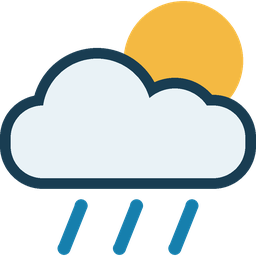

# MeteoSwiss for Home Assistant — maintained fork



**Swiss weather, forecasts and natural-hazard warnings in Home Assistant,
alongside pollen and air quality.** Use them in your own dashboards and
automations, with bundled translations and a documented path for existing users.

This fork continues [LNKtwo/ha-meteoswiss](https://github.com/LNKtwo/ha-meteoswiss)
and brings reviewed corrections together in one maintained version. The original
project provides the foundation; its MIT licence and attribution are retained.
This is an independent community project, not an official MeteoSwiss product.

**Stable [8.2.0](https://github.com/martins-netizen/ha-meteoswiss/releases/tag/8.2.0)
is published.** It includes explicit pollen-station selection during setup and
the reviewed Beta2 component code. Follow the setup or migration guide below.

## Four places: what each one is used for

**HA home, pollen measurements, weather measurements and weather forecasts can
refer to four different places.** Each has a specific purpose:

| Place | What it is used for | Example |
|---|---|---|
| **1. HA home location** | The HA base coordinates are used for **modelled air quality, modelled pollen and optional UV via Open-Meteo**. They also define the **MeteoSwiss weather-forecast location** when you keep or explicitly return to the original base coordinates. | Your configured home position in **Kloten**. |
| **2. Pollen measurement station** | **Measured pollen concentrations** from the selected MeteoSwiss pollen station. Independent of weather measurements and weather forecasts. You might want to choose a station near your HA home location. | **Zürich (PZH)**. |
| **3. Weather measurement station** | **Measured current temperature, wind, rain and other observations**, shown on the station device and its original weather entity. You might want to choose a station near your HA home location. | **Zürich/Kloten**. |
| **4. Weather forecast location** | **ICON predictions:** hourly/daily forecasts, eight today/tomorrow sensors and calculated heating degree days. In b2, the separate forecast weather entity also shows the chosen point's **current model hour**, which is a prediction rather than a station measurement. | A selected town/postcode point or **Säntis** POI. |

**Station-condition follow-up (development after b3):** the station weather
row also gains a **modelled condition for the measuring station's own location**.
Its numeric values remain measurements; the condition is identified separately
as modelled. See [the source and failure behaviour](docs/STATION_WEATHER_CONDITION.md).

For example: **HA home in Kloten, pollen measurements from Zürich, weather
measurements from Zürich/Kloten and weather forecasts for Säntis.** Changing
the forecast to Säntis changes its ICON predictions and calculated HGT. The
Kloten observations, selected pollen measurement station and modelled
AQ/pollen/UV at the base location retain their own places.

**Measured pollen and modelled pollen are different:** the pollen station
supplies measurements; modelled pollen uses the base coordinates. If you choose
an explicit forecast point, that point replaces the base location **only for
the ICON weather forecast role**.

**Warnings use a separate warning postcode**, for example **8302** for Kloten.
A postcode entered in the forecast search selects a forecast point; the warning
postcode selects the warning area. Enter them independently, even when both
are 8302. Choosing Säntis for the forecast does not move the warning postcode
or establish warnings for that mountain. A town/postcode forecast point is a
provider-assigned point, not the exact coordinates of your home.

The alternative **Open-Meteo current-weather source** uses modelled current
conditions at its entered coordinates in place of a weather measurement station.
These entered coordinates also become that entry's base location for
AQ/pollen/UV and its default weather forecast. An explicit forecast selection
still changes only the ICON forecast role.

**B3 test track:** the existing entry’s **Configure (gear)**
now brings the **weather measuring station, measured-pollen station and forecast
location into one dialog**, alongside the independent warning postcode. A
postcode/town/POI search continues inside the same flow; cancelling preserves
all previous choices. The HA home location remains a general HA setting.
See [the unified settings and clock-change guide](docs/CALENDAR_AND_LOCATION_SETTINGS.md)
for availability and the focused checks. Published b1/b2 still use Configure for
pollen and **three-dot menu → Reconfigure** for forecasts.

The [selection guide](docs/FORECAST_LOCATION_SETUP.md) and
[data/settings reference](docs/USAGE.md) explain the roles. The b2 named
forecast device/card change is covered in [display and migration](docs/FORECAST_DISPLAY.md).

## Why choose this fork?

- **Less manual patching.** Reviewed fixes and German, English, French and Italian
  UI catalogues ship together. You do not need to copy translation files after
  each update.
- **Warnings with a checked meaning.** The current App v3 source and verified
  warning catalogue address the old wind-code mismatch and the demonstrated
  omission of drought in v1. Active and upcoming warnings retain their severity,
  validity and event text. See the [evidence and limits](docs/WARNING_CODES.md).
- **Understand missing data.** A real zero, a missing individual value and an
  unavailable source are distinct. A failed warning source is not an all-clear;
  an optional pollen or air-quality outage does not block station setup.
- **Build on your existing installation.** Existing setup and the IDs of retained
  entities and statistics are preserved. The [migration guide](docs/MIGRATION.md)
  explains the retired seasonal heating-degree entity, warning-filter changes,
  backup and recovery.
- **See how changes are checked.** Public review history, automated HA tests,
  CodeQL, SonarCloud and HACS validation accompany changes. The [overall review](docs/RELEASE_REVIEW_2026-10-24.md)
  records evidence and remaining work; the fork has its own support and private
  security-reporting routes.

On an older installation, check which fixes it already contains; not every
listed capability is new compared with every upstream version or local patch.
Forecasts and warning availability still depend on the external data providers.

Read the [plain-language overview](docs/GETTING_STARTED.md#what-this-fork-provides).

## Quality goals: Bronze, Silver and Gold

We use the [Home Assistant Integration Quality Scale](https://contributors.home-assistant.io/core/quality-scale/)
as an engineering checklist. **This fork has no officially awarded tier.**
The following is our documented self-assessment of the **8.3.0b3 test track**;
it does not describe every feature of stable 8.2.0.

| Goal | What it means for you | Current evidence and remaining work |
|---|---|---|
| **Bronze: a sound foundation** | Setup in HA, stable entity identities, tested setup and clear instructions. | The applicable technical rules have evidence in our checklist. The Core branding requirement remains unverified; local HACS images do not establish it. |
| **Silver: reliable operation** | Clear unavailable states, recovery from source failures, clean unloading and a maintained support route. | All applicable Silver rules have recorded evidence, including more than 95% coverage per module. A complete tier also needs its Bronze prerequisites; focused b3 HA acceptance is still pending. |
| **Gold: a more complete user experience** | Easier configuration, useful diagnostics, translations and actionable help. | Several features already exist, including the unified location dialog. Remaining work includes HA Repairs, icon/error translations, diagnostic defaults, metadata and stale-device handling; the full checklist also records the reconfiguration-route review and proposed exemptions. |

The [rule-by-rule assessment](docs/QUALITY_SCALE.md) links the scope, test evidence
and remaining boundaries. HACS validation and default-catalogue inclusion are
separate from these HA quality tiers. We do not add an awarded-tier badge or
manifest claim on the strength of this self-assessment.

## Start here

| Your situation | Guide |
|---|---|
| First installation | [Step-by-step setup](docs/GETTING_STARTED.md) |
| Existing MeteoSwiss installation | [Switch or update safely](docs/MIGRATION.md) |
| Experienced HA user | [Data and settings](docs/USAGE.md), [warning codes](docs/WARNING_CODES.md), [architecture](docs/ARCHITECTURE.md) |
| Settings, missing data or troubleshooting | [English usage reference](docs/USAGE.md) |

## Release status

**Published stable: [8.2.0](https://github.com/martins-netizen/ha-meteoswiss/releases/tag/8.2.0)**,
22 October 2026. [Release notes](docs/RELEASE_8.2.0.md) describe its scope and
migration. HACS installation, update and recovery were confirmed within the
[recorded acceptance scope](docs/HACS_ACCEPTANCE.md).

**Published test prerelease: [8.3.0b1](https://github.com/martins-netizen/ha-meteoswiss/releases/tag/8.3.0b1)**,
24 October 2026. It adds postcode/town/POI forecast selection, eight forecast
sensors and reviewed source/lifecycle improvements. Its [notes](docs/RELEASE_8.3.0b1.md)
and [focused test checklist](docs/ACCEPTANCE_8.3.0b1.md) define the published
scope. Initial operator testing confirmed the separate Säntis station/POI
choices and exposed ambiguous forecast values under a Kloten heading.

**Published follow-up prerelease: [8.3.0b2](https://github.com/martins-netizen/ha-meteoswiss/releases/tag/8.3.0b2)**, with a
[separate named forecast device and weather entity](docs/FORECAST_DISPLAY.md).
It keeps current conditions and selected-place predictions distinct and includes
[one card/action target change](docs/FORECAST_DISPLAY.md#update-an-existing-card-or-forecast-action-once).
See [b2 notes](docs/RELEASE_8.3.0b2.md) and its [focused protocol](docs/ACCEPTANCE_8.3.0b2.md).
This correction is not in 8.3.0b1. The calendar-day and unified-settings corrections described above are **not
in published b2**. Publication of the exact b3 package and focused HA acceptance remain separate
steps before a stable 8.3.0 release.
**8.3.0b3 test track** includes those reviewed corrections:
[release notes](docs/RELEASE_8.3.0b3.md) and
[focused acceptance](docs/ACCEPTANCE_8.3.0b3.md). It brings all three location
choices into the same Configure dialog and validates whole Swiss calendar days
through clock changes (e.g. from summer time to winter time). Check the
[announced GitHub release](https://github.com/martins-netizen/ha-meteoswiss/releases/tag/8.3.0b3)
for availability and install that exact release through HACS; a source version
alone does not establish publication.
Stable 8.2.0 remains the normal installation route. Neither a branch nor an
open PR is an installation target.
The [overall review](docs/RELEASE_REVIEW_2026-10-24.md) and
[readiness record](docs/RELEASE_READINESS.md) retain evidence.

Minimum supported/tested HA is **2026.8.3**, with CI on **2026.10.1** and
additional local/practical evidence on **2026.10.2**. The operator also reports
a successful existing-beta test on **2026.10.3**; that is separate from
automated testing and from acceptance of the new corrections. HACS default-catalogue
inclusion and an official HA quality tier have not been granted.

## Data and compatibility

- SwissMetNet observations and hourly precipitation statistics.
- MeteoSwiss ICON Seamless forecasts via Open-Meteo.
- Unreleased development after 8.2.0: [eight forecast sensors](docs/FORECAST_SENSORS.md)
  for today/tomorrow, including matching maximum-probability rain windows.
- Active/upcoming weather and natural-hazard warnings through the MeteoSwiss
  postcode feed, with explicit feed availability. This includes flood (BAFU)
  and avalanche (SLF) warnings when supplied for the selected postcode; it is
  not a separate river-gauge or full avalanche-bulletin integration.
- Measured pollen, pollen forecasts and air quality.
- Complete German, English, French and Italian UI catalogues.

The integration domain remains `meteoswiss`. Existing config entries and the
IDs of retained entities/statistics are preserved. The obsolete forecast-only
season-HGT entity is intentionally retired; review that exception in the
[migration guide](docs/MIGRATION.md). Warning automations should use numeric `warn_type`
and `warn_level`, and must treat an unavailable source separately from no alert.

Warnings use the App v3 source and its [verified thirteen-family catalogue](docs/WARNING_CODES.md).
Before updating an existing installation, review warning filters: **0 is Wind,
4 is Slippery Roads**; wind/thunderstorm/rain uses `[0, 1, 2]`. Detailed messages
distinguish storm/heavy-rain/snowfall events. Thaw (6) is recognized if supplied.
Dashboard and automation migration is a separate deployment step.

## Cache Statistics

The optional **Cache Statistics** diagnostic shows how often a local lookup
reuses data still within its cache lifetime. A higher hit rate can mean fewer
repeated downloads; it does not measure forecast accuracy or service health.
There is no target percentage to achieve. See [what the counters mean](docs/USAGE.md#cache-statistics-what-the-numbers-mean).

## Installation and updates

An existing installation must first be checked for its source and installed
commit/version. Do not remove or recreate the integration/config entry.
Stable 8.2.0 is published. For installation or update:

1. Back up Home Assistant and keep the recovery key. Existing users first follow
   the [migration and warning-consumer checks](docs/MIGRATION.md).
2. In **HACS → menu → Custom repositories**, add
   `https://github.com/martins-netizen/ha-meteoswiss` as **Integration**.
   Skip this step if that repository is already present.
3. Open Download/Redownload, expand **Need a different version?**, and explicitly
   select **8.2.0** in **Release**. Check the announced version before confirming
   the download, then restart Home Assistant. Do not substitute a branch or commit.
   Do not keep two HACS repositories managing the same `meteoswiss` directory.
4. **New users only:** add **MeteoSwiss** under **Settings → Devices & services**.
   In the first dialog choose **MeteoSwiss STAC API (Swiss Stations)** and a
   **measured-pollen station**. Keep 600 seconds initially. Continue to the next
   dialog to select the weather station and four-digit warning postcode.
5. Check the HA home location for forecasts/AQ. **Configure** later changes the
   interval and measured-pollen station, not the weather station or postcode.

**Unreleased development:** the next setup/Configure flow removes the polling
field and schedules new observation entries automatically at 600 seconds.
Existing individual intervals remain effective when upgrading or changing the
pollen station. The [forecast-location dialog](docs/FORECAST_LOCATION_SETUP.md)
adds a separate, explicit weather forecast choice; **Reconfigure** later changes
that choice. It leaves observations, warning postcode and AQ/pollen/UV locations
intact. These are not yet part of the published 8.2.0 instructions above.

Existing Beta1 entries retain their settings and can select a pollen station
under Configure. Update through HACS while keeping the existing HA entry.

Existing users keep their existing HA entry; they do not add it a second time.
`development` is the maintained default branch and `main` is an upstream mirror.
Neither branch name is a release approval. API keys or terminal commands are
not needed for the normal released installation.

The optional [shared warning template](examples/button-card-warnings.yaml) uses
labels supplied by the integration. It can replace duplicated dashboard warning
dictionaries after a separate dashboard check; it is not installed automatically.

See [setup, all parameters, removal and troubleshooting](docs/USAGE.md).

## Development and operation

- [Next-release plan: location/POIs, Silver and Gold](docs/NEXT_RELEASE_PLAN.md)
- [Overall release review of 24 October 2026](docs/RELEASE_REVIEW_2026-10-24.md)
- [Historical review of 17 October 2026](docs/REVIEW_2026-10-17.md)
- [Quality roadmap and measured gaps](docs/QUALITY_SCALE.md)
- [Architecture and data contracts](docs/ARCHITECTURE.md)
- [Maintenance, acceptance and releases](docs/MAINTENANCE.md)
- [HACS publication checklist and release-note outline](docs/PUBLISHING.md)
- [Branch policy](DEVELOPMENT.md)
- [Changes](CHANGELOG.md)

```sh
python -m pip install -r requirements_test.txt
python scripts/check_translations.py
python -m pytest -q --cov=custom_components.meteoswiss --cov-branch --cov-report=json:coverage.json
python scripts/check_quality_coverage.py
```

`development` is the protected integration branch; `main` tracks upstream.
Use this fork's [issue tracker](https://github.com/martins-netizen/ha-meteoswiss/issues)
for ordinary problems and
[private vulnerability reporting](https://github.com/martins-netizen/ha-meteoswiss/security/advisories)
for confidential security reports. Bug reports should
include the installed fork version/commit, HA version, relevant states and
redacted logs. Do not upload full private backups or credentials.
Existing development PRs remain the review record.
Provider outages must remain distinguishable from a valid empty/no-danger value.

