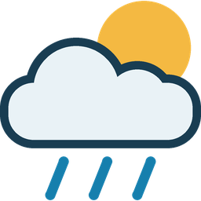

# MeteoSwiss for Home Assistant — maintained fork

**Swiss weather, forecasts and natural-hazard warnings in Home Assistant,
alongside pollen and air quality.** Use them in your own dashboards and
automations, with bundled translations and a documented path for existing users.

This fork continues [LNKtwo/ha-meteoswiss](https://github.com/LNKtwo/ha-meteoswiss)
and brings reviewed corrections together in one maintained version. The original
project provides the foundation; its MIT licence and attribution are retained.
This is an independent community project, not an official MeteoSwiss product.

**Start with the [latest published stable release](https://github.com/martins-netizen/ha-meteoswiss/releases/latest).**
This guide describes the **8.3 series**; [8.3.0 release notes](docs/RELEASE_8.3.0.md)
explain the changes from 8.2.0. Use a published release, not a branch.

**Published test version:** [8.3.5b1](https://github.com/martins-netizen/ha-meteoswiss/releases/tag/8.3.5b1)
was published on 13 November 2026. It includes history-preserving wind
statistics, HGT metadata, translated defaults and diagnostic lifecycle changes.
**8.3.4 remains the latest stable release.** The beta requires HA
**2026.11.0 or newer**; operator installation and focused acceptance are still
pending. Before a beta update, read the [focused acceptance plan](docs/ACCEPTANCE_8.3.5b1.md),
including its test-copy requirement for existing arithmetic wind statistics,
backup and rollback boundary. See [publication evidence](docs/RELEASE_EVIDENCE_8.3.5b1.md)
and the unchanged [release notes](docs/RELEASE_8.3.5b1.md).

**Existing 8.3.4/8.3.5b1 users:** read the
[archive-and-keep upgrade default](docs/UPGRADING_8.3.5.md). The prepared HGT
follow-up preserves old statistics and clears the resolved state-class Repair
through native HA recomputation. It is not yet included in published 8.3.5b1;
no history deletion or reinstall of b1 is the update procedure.

**Available in the community catalogue.** On HA **2026.11 or newer**, open
**Settings → Marketplace** and search for **MeteoSwiss**. On older HA versions,
use HACS. Check that the repository is **martins-netizen/ha-meteoswiss**.
Existing HACS installations migrate automatically when HA upgrades to 2026.11;
do not reinstall HACS or recreate the MeteoSwiss entry.

## Four places: what each one is used for

**HA home, pollen measurements, weather measurements and weather forecasts can
refer to four different places.** Each has a specific purpose:

| Place | What it is used for | Example |
|---|---|---|
| **1. HA home location** | The HA base coordinates are used for **modelled air quality, modelled pollen and optional UV via Open-Meteo**. They also define the **MeteoSwiss weather-forecast location** when you keep or explicitly return to the original base coordinates. | Your configured home position in **Kloten**. |
| **2. Pollen measurement station** | **Measured pollen concentrations** from the selected MeteoSwiss pollen station. Independent of weather measurements and weather forecasts. You might want to choose a station near your HA home location. | **Zürich (PZH)**. |
| **3. Weather measurement station** | **Measured current temperature, wind, rain and other observations**, shown on the station device and its original weather entity. You might want to choose a station near your HA home location. | **Zürich/Kloten**. |
| **4. Weather forecast location** | **ICON predictions:** hourly/daily forecasts, eight today/tomorrow sensors and calculated heating degree days. The separate forecast weather entity also shows the chosen point's **current model hour**, which is a prediction rather than a station measurement. | A selected town/postcode point or **Säntis** POI. |

The station weather row can also show a **modelled condition for the measuring station's own location**.
Its numeric values remain measurements; the condition is identified separately
as modelled. See [the source and failure behaviour](docs/STATION_WEATHER_CONDITION.md).

Find nearby SwissMetNet stations on the official
[MeteoSwiss measurement-network map](https://www.meteoswiss.admin.ch/services-and-publications/applications/measuring-networks.html),
then select the station by name in HA. The [setup guide](docs/GETTING_STARTED.md#3-select-pollen-weather-and-warning-locations)
also explains the map-link help included in stable 8.3.2.

For example: **HA home in Kloten, pollen measurements from Zürich, weather
measurements from Zürich/Kloten and weather forecasts for Säntis.** Changing
the forecast to Säntis changes its ICON predictions and calculated HGT. The
Kloten observations, selected pollen measurement station and modelled
AQ/pollen/UV at the base location retain their own places.

**Measured pollen and modelled pollen are different:** the pollen station
supplies measurements; modelled pollen uses the base coordinates. If you choose
an explicit forecast point, that point replaces the base location **only for
the ICON weather forecast role**.

**Warnings use a separate warning postcode**, for example **8302** for Kloten.
A postcode entered in the forecast search selects a forecast point; the warning
postcode selects the warning area. Enter them independently, even when both
are 8302. Choosing Säntis for the forecast does not move the warning postcode
or establish warnings for that mountain. A town/postcode forecast point is a
provider-assigned point, not the exact coordinates of your home.

The alternative **Open-Meteo current-weather source** uses modelled current
conditions at its entered coordinates in place of a weather measurement station.
These entered coordinates also become that entry's base location for
AQ/pollen/UV and its default weather forecast. An explicit forecast selection
still changes only the ICON forecast role.

The existing entry's **Configure (gear)** brings the **weather measuring
station, measured-pollen station and forecast location into one dialog**,
alongside the independent warning postcode. A postcode/town/POI search continues
inside that flow; cancelling preserves previous choices. The HA home location
remains a general HA setting. See the [unified settings and clock-change guide](docs/CALENDAR_AND_LOCATION_SETTINGS.md).

The [selection guide](docs/FORECAST_LOCATION_SETUP.md) and
[data/settings reference](docs/USAGE.md) explain the roles. The named
forecast device/card change is covered in [display and migration](docs/FORECAST_DISPLAY.md).

## Why choose this fork?

- **Less manual patching.** Reviewed fixes and German, English, French and Italian
  UI catalogues ship together. You do not need to copy translation files after
  each update.
- **Warnings with a checked meaning.** The current App v3 source and verified
  warning catalogue address the old wind-code mismatch and the demonstrated
  omission of drought in v1. Active and upcoming warnings retain their severity,
  validity and event text. See the [evidence and limits](docs/WARNING_CODES.md).
- **Understand missing data.** A real zero, a missing individual value and an
  unavailable source are distinct. A failed warning source is not an all-clear;
  an optional pollen or air-quality outage does not block station setup.
- **Build on your existing installation.** Existing setup and the IDs of retained
  entities and statistics are preserved. The [migration guide](docs/MIGRATION.md)
  explains the retired seasonal heating-degree entity, warning-filter changes,
  backup and recovery.
- **See how changes are checked.** Public review history, automated HA tests,
  CodeQL, SonarCloud and HACS validation accompany changes. The [overall review](docs/RELEASE_REVIEW_2026-10-24.md)
  records evidence and remaining work; the fork has its own support and private
  security-reporting routes.

On an older installation, check which fixes it already contains; not every
listed capability is new compared with every upstream version or local patch.
Forecasts and warning availability still depend on the external data providers.

Read the [plain-language overview](docs/GETTING_STARTED.md#what-this-fork-provides).

## Quality goals: Bronze, Silver and Gold

We follow the [Home Assistant Integration Quality Scale](https://contributors.home-assistant.io/core/quality-scale/)
as an engineering checklist, with rule-by-rule code, test and documentation
evidence. The following summarises the **8.3 series**, with the b4 runtime and
the bounded repair/map and 8.3.2b1 shared-settings follow-ups accepted by the operator. Home Assistant's [custom-integration guidance](https://contributors.home-assistant.io/marketplace/guides/integrations/#keep-up-with-home-assistant)
explains that custom integrations have no official quality tiers; Bronze,
Silver and Gold below identify the rules we use to guide improvements.

| Goal | What it means for you | Current evidence and remaining work |
|---|---|---|
| **Bronze: a sound foundation** | Setup in HA, stable entity identities, tested setup and clear instructions. | The checklist records setup/configuration tests, identity checks, installation guides and valid bundled brand images. |
| **Silver: reliable operation** | Clear unavailable states, recovery from source failures, clean unloading and a maintained support route. | All applicable Silver rules have recorded evidence, including more than 95% coverage per module. The checklist also records the underlying Bronze rules; focused b4 HA acceptance is operator-confirmed. |
| **Gold: a more complete user experience** | Easier configuration, useful diagnostics, translations and actionable help. | The shared location dialog and actionable repair notices have bounded evidence; the repair/map follow-up was accepted in 8.3.1b1. Icons/error translations are released in 8.3.3; diagnostic defaults and bounded provider/service metadata are delivered in stable 8.3.4, first introduced in the accepted 8.3.4b1 beta. Remaining work includes device classes/wind statistics, entity translations and historical stale-device handling. The discovery-rule applicability review documents two service-specific exemptions and retains the limits of fixed-group lifecycle evidence. The five-step shared-Reconfigure check was reported positive on Core 2026.10.4. |

The [rule-by-rule assessment](docs/QUALITY_SCALE.md) links the scope, test evidence
and remaining work; the [discovery and device-lifecycle review](docs/GOLD_APPLICABILITY.md)
explains applicability and the seven virtual service groups.
[HACS catalogue admission](docs/HACS_ACCEPTANCE.md#hacs-catalogue-admission)
is complete and provides a separate distribution/review milestone. We keep the
quality checklist as a transparent engineering record, without an awarded-tier
badge or manifest claim.

The [privacy, architecture and security review](docs/PRIVACY_SECURITY_REVIEW.md)
records verified controls and remaining checks. Providers receive the source IP
and requested location; diagnostic redaction does not hide those requests from
the provider. See [location privacy before setup](docs/GETTING_STARTED.md#location-privacy-before-setup).

**Unreleased diagnostic-name follow-up:** the two optional technical helpers
and their shared service groups have translated default names in DE/EN/FR/IT.
Existing IDs, personal names and enabled/disabled choices are retained. Technical
states/attributes keep their compatibility format; see [names and limits](docs/DIAGNOSTIC_TRANSLATIONS.md).
The [dated security inventory](docs/PRIVACY_SECURITY_REVIEW.md#owner-authenticated-alert-inventory)
records no open alerts as of 11 November 2026; it is separate from Gold completion.

**Unreleased dependency-security gate:** CI checks every package/version in both
universal test locks against known advisories, including foreign-platform
selections. Active advisories and unknown results fail the existing `tests`
merge gate. A separate daily workflow uses the same read-only check; see
[scope, failure handling and limits](docs/DEPENDENCY_ADVISORIES.md).

**Unreleased shared-diagnostic lifecycle fix:** keep both helper entity/device
IDs and personal settings when their owner unloads or another entry starts
first. A loaded peer takes over through its existing platform; its weather
coordinators are not reloaded. Ambiguous historical bindings raise a translated
repair instead of being merged or deleted. See [ownership and recovery](docs/SHARED_DIAGNOSTIC_LIFECYCLE.md).

**Unreleased manual device removal:** HA's normal device-page confirmation can
remove an unambiguous empty service shell for an entry that no longer exists.
Current, disabled, shared, bound or linked groups stay protected. This adds no
automatic cleanup or production orphan claim; see [approval and limits](docs/DEVICE_REMOVAL.md).

**Unreleased service-group names:** current weather, modelled air quality/pollen,
warnings and measured pollen use native DE/EN/FR/IT labels. English defaults,
raw station/postcode text, existing IDs and personal names remain intact.
See [names, language changes and retained history](docs/SERVICE_GROUP_TRANSLATIONS.md).

**Complete name coverage:** native tests verify all 45 registered entities per
provider in DE/EN/FR/IT, including personal choices and device-name inheritance.
See the [entity-name inventory and remaining acceptance](docs/ENTITY_NAME_TRANSLATIONS.md).

**Accepted 8.3.1b1 follow-up:** [actionable repair notices](docs/REPAIRS.md) guide
users from an invalid saved forecast location to the existing settings. Official
station-map links help find nearby SwissMetNet stations. The operator confirmed
the requested version/visual check on 26 October. Published stable [8.3.1](docs/RELEASE_8.3.1.md) retains that runtime.
The published [8.3.2b1 follow-up](docs/RELEASE_8.3.2b1.md) adds the complete
Reconfigure route. The operator reported all five focused steps positive on
HA Core **2026.10.4**. Stable [8.3.2](docs/RELEASE_8.3.2.md) was published on
28 October; on 30 October the operator confirmed its HACS download, restart
and working operation. See [the bounded evidence](docs/RELEASE_EVIDENCE_8.3.2.md).

## Start here

| Your situation | Guide |
|---|---|
| First installation | [Step-by-step setup](docs/GETTING_STARTED.md) |
| Existing MeteoSwiss installation | [Switch or update safely](docs/MIGRATION.md) |
| Experienced HA user | [Data and settings](docs/USAGE.md), [warning codes](docs/WARNING_CODES.md), [architecture](docs/ARCHITECTURE.md) |
| Settings, missing data or troubleshooting | [English usage reference](docs/USAGE.md) |

## Release status

**[Stable 8.3.4 is published](https://github.com/martins-netizen/ha-meteoswiss/releases/tag/8.3.4)
and is the normal installation and update target.** Publication on
**7 November 2026 at 21:24:27 UTC** was independently verified, including the
release tag, approved English notes and selection as latest stable. See the
[publication evidence](docs/RELEASE_EVIDENCE_8.3.4.md).

Compared with 8.3.3, this maintenance and quality release provides:

- **Verified HA 2026.11 support**, using the matching official HA test package
  and reproducible dependency locks.
- **A cleaner first setup**, with optional diagnostic helpers initially disabled.
  Existing enabled helpers, personal settings, names, icons and IDs are retained.
- **Clearer data-source information**, including modelled Open-Meteo current
  conditions and explicit virtual data-service groups.

Read [what the update means for existing users](docs/RELEASE_8.3.4.md#why-upgrade-from-833).
Use **Settings → Marketplace** on HA 2026.11+, or HACS on older HA. Keep the
existing configured entry, actually Download/Redownload **8.3.4** and restart HA
once, following the [short stable update](docs/ACCEPTANCE_8.3.4.md). Refreshing
repository information alone does not download files. The
[latest stable page](https://github.com/martins-netizen/ha-meteoswiss/releases/latest)
is authoritative.

**Earlier beta 8.3.4b1 is provenance, not the current installation target.**
Its normal operation was operator-confirmed on **HA Core 2026.11.0 / HA OS 18.4**.
Stable 8.3.4 retains all 39 non-version component files from that accepted beta;
only two version fields change. Historical beta references and their
[bounded evidence](docs/RELEASE_EVIDENCE_8.3.4b1.md) remain accurate. The HGT
statistics follow-up stays outside this stable release.

Earlier stable **8.3.3** remains an immutable previous release and recovery
option. Its actual installation and normal operation were operator-confirmed
on 30 October; see [that release's evidence](docs/RELEASE_EVIDENCE_8.3.3.md).
Earlier beta, shared-settings, clean-install and restore checks remain complete
within their recorded scopes. An intermediate beta or older stable download
is not required.

**Unreleased compatibility change.** New releases require **HA 2026.11.0 or
newer**. This Core baseline brings fixes for known vulnerabilities in
dependencies shipped with older Core releases. CI tests **2026.11.0** and
**2026.11.1** with their matching official test packages.
[Core security rationale](DEVELOPMENT.md#supported-home-assistant-versions)

Published stable **8.3.4** declared **HA 2026.8.3** as its minimum. Its
package-merge jobs passed **2,225 tests plus 83 subtests** on HA 2026.8.3 and
2026.11.0. For installations on older HA, follow the
[8.3.4 setup guide](https://github.com/martins-netizen/ha-meteoswiss/blob/8.3.4/docs/GETTING_STARTED.md).

Native icons and translated errors are retained from stable 8.3.3. The
[Gold checklist](docs/QUALITY_SCALE.md) still has separate remaining work.

**Unreleased wind-statistics change.** Wind direction uses HA's circular angle
statistics after a verified migration. Existing arithmetic statistics are kept
under a separate archive ID; new circular statistics use the original sensor.
Review [chart impact, repair notices and rollback](docs/WIND_STATISTICS_MIGRATION.md)
before updating. Calm wind has no direction and is reported as unknown.

## Data and compatibility

- SwissMetNet observations and hourly precipitation statistics.
- MeteoSwiss ICON Seamless forecasts via Open-Meteo.
- [Eight forecast sensors](docs/FORECAST_SENSORS.md)
  for today/tomorrow, including matching maximum-probability rain windows.
- Active/upcoming weather and natural-hazard warnings through the MeteoSwiss
  postcode feed, with explicit feed availability. This includes flood (BAFU)
  and avalanche (SLF) warnings when supplied for the selected postcode; it is
  not a separate river-gauge or full avalanche-bulletin integration.
- Measured pollen, pollen forecasts and air quality.
- Complete German, English, French and Italian UI catalogues.

The integration domain remains `meteoswiss`. Existing config entries and the
IDs of retained entities/statistics are preserved. The obsolete forecast-only
season-HGT entity is intentionally retired; review that exception in the
[migration guide](docs/MIGRATION.md). Warning automations should use numeric `warn_type`
and `warn_level`, and must treat an unavailable source separately from no alert.

Warnings use the App v3 source and its [verified thirteen-family catalogue](docs/WARNING_CODES.md).
Before updating an existing installation, review warning filters: **0 is Wind,
4 is Slippery Roads**; wind/thunderstorm/rain uses `[0, 1, 2]`. Detailed messages
distinguish storm/heavy-rain/snowfall events. Thaw (6) is recognized if supplied.
Dashboard and automation migration is a separate deployment step.

## Cache Statistics

The optional **Cache Statistics** diagnostic shows how often a local lookup
reuses data still within its cache lifetime. A higher hit rate can mean fewer
repeated downloads; it does not measure forecast accuracy or service health.
There is no target percentage to achieve. See [what the counters mean](docs/USAGE.md#cache-statistics-what-the-numbers-mean).

## Installation and updates

An existing installation must first be checked for its source and installed
commit/version. Do not remove or recreate the integration/config entry.
For installation or update:

1. Back up Home Assistant and keep the recovery key. Existing users first read
   the [migration and warning-consumer checks](docs/MIGRATION.md).
2. On **HA 2026.11+**, open **Settings → Marketplace**, acknowledge the community-code
   notice if prompted, and search for **MeteoSwiss**. Verify
   **martins-netizen/ha-meteoswiss**. For 8.3.4 on older HA, open **HACS**.
   For a different installed source, follow migration first. The
   [custom-repository fallback](docs/GETTING_STARTED.md#if-the-repository-is-not-listed)
   explains **Add from link** and the older HACS menu.
3. Select a published stable release that supports your HA version. For an **update**,
   use **Settings → Updates** on HA 2026.11+, then restart through the resulting
   repair notice. For 8.3.4 on older HA, use **Download/Redownload → Need a
   different version? → Release** in HACS, then download and restart.
   Refreshing metadata alone does not install files. Keep one software owner
   for `meteoswiss`.
4. **New users only:** Marketplace opens setup after the first installation;
   no restart is normally needed for an integration not previously loaded.
   Alternatively use **Settings → Devices & services → Add integration → MeteoSwiss**.
   On older HA, restart after the HACS download before adding the integration.
   Choose weather source, measured-pollen station, observation station/base
   coordinates, warning postcode and the independent forecast town/POI.
5. Existing users retain their HA entry. **Configure** edits the three MeteoSwiss
   location choices together; the HA home location remains in HA's own settings.

New observation entries refresh automatically every **600 seconds**; existing
individual intervals remain effective. No polling field is shown. The
[forecast selection guide](docs/FORECAST_LOCATION_SETUP.md) explains search,
confirmation and reset. With an explicit catalogue forecast, update an existing
forecast card/action target once as described in [display migration](docs/FORECAST_DISPLAY.md).
UI languages ship with the software; no API key or terminal command is required.
`development` is the maintained default branch; `main` tracks upstream.

The optional [shared warning template](examples/button-card-warnings.yaml) uses
labels supplied by the integration. It can replace duplicated dashboard warning
dictionaries after a separate dashboard check; it is not installed automatically.

See [setup, all parameters, removal and troubleshooting](docs/USAGE.md).

## Development and operation

- [Location/POI implementation plan and later quality work](docs/NEXT_RELEASE_PLAN.md)
- [Overall release review of 24 October 2026](docs/RELEASE_REVIEW_2026-10-24.md)
- [Historical review of 17 October 2026](docs/REVIEW_2026-10-17.md)
- [Quality roadmap and measured gaps](docs/QUALITY_SCALE.md)
- [Architecture and data contracts](docs/ARCHITECTURE.md)
- [Maintenance, acceptance and releases](docs/MAINTENANCE.md)
- [HACS publication checklist and release-note outline](docs/PUBLISHING.md)
- [Branch policy](DEVELOPMENT.md)
- [Changes](CHANGELOG.md)

Follow the [local compatibility checks](DEVELOPMENT.md#local-compatibility-checks)
in separate environments for both supported HA fixtures. The shared recipe
includes the Python/pip bootstrap check, constrained CA-bundle installation,
offline uv policy, translations and full line/branch coverage gates.

`development` is the protected integration branch; `main` tracks upstream.
Use this fork's [issue tracker](https://github.com/martins-netizen/ha-meteoswiss/issues)
for ordinary problems and
[private vulnerability reporting](https://github.com/martins-netizen/ha-meteoswiss/security/advisories)
for confidential security reports. Bug reports should
include the installed fork version/commit, HA version, relevant states and
redacted logs. Do not upload full private backups or credentials.
Existing development PRs remain the review record.
Provider outages must remain distinguishable from a valid empty/no-danger value.

